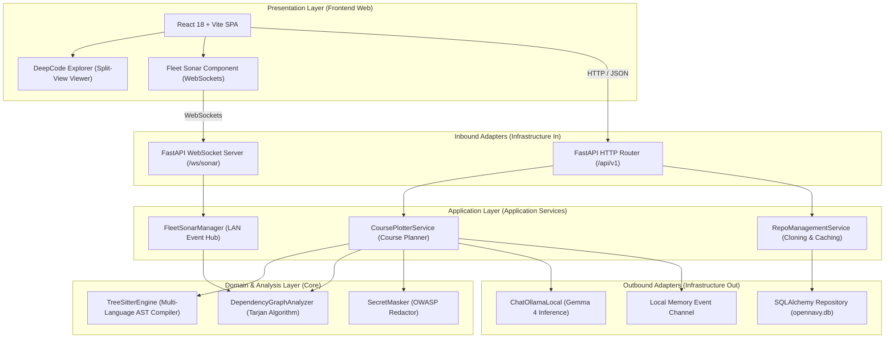

# OpenNavy Software Architecture Specification

## 1. Overview and Design Principles

OpenNavy is architected following the principles of Hexagonal Architecture (Ports and Adapters) and Clean Architecture, prioritizing data sovereignty, deterministic isolation, and maintainability for the open-source community.

### Core Principles:
1. **Local-First Sovereignty:** The system operates entirely without external internet connectivity. Language inference, syntax analysis, and multiplayer coordination occur strictly within the machine boundary or local area network (LAN).
2. **Structural Determinism over AI Hallucination:** Function lookup, class resolution, and dependency graph generation are solved deterministically via Tree-sitter AST parsing and Tarjan's Strongly Connected Components (SCC) algorithm. Generative AI (Google Gemma 4) serves exclusively as a reasoning, synthesis, and planning layer.
3. **Loose Coupling and High Cohesion:** Code analysis logic contains no web framework or inference library dependencies. Any infrastructure adapter can be swapped without touching domain logic.

---

## 2. Layered Architecture Diagram



---

## 3. Detailed Component Breakdown

### A. Domain Layer (Core Analysis Engine)
Located in `backend/app/analyzers/` with zero external web or database framework dependencies:
* **`treesitter_engine.py`:** Leverages native compiled Tree-sitter grammars to generate abstract syntax representations across Python, TypeScript, JavaScript, Go, and Java. Extracts function signatures, invocation calls, and import directives cleanly without distortion from comments or string literals.
* **`dependency_graph.py`:** Constructs the directed module import and call graph. Implements Tarjan's Strongly Connected Components (SCC) algorithm in linear time O(V + E) to pinpoint architectural cycles (Code Reefs).
* **`secret_masker.py`:** Scans and redacts personal access tokens, private keys, and passwords before any source code snippet reaches the language model.

### B. Application Layer (Application Services)
Orchestrates business workflows and cross-cutting use cases:
* **`CoursePlotterService` (`backend/app/api/v1/endpoints/course.py`):** 
  1. Ingests technical missions (issue text or error screenshots).
  2. Calls Tree-sitter to correlate candidate symbols.
  3. Executes Tarjan analysis to calculate architectural blast radius.
  4. Builds structured prompts for Google Gemma 4 requesting strict JSON outputs.
  5. Broadcasts newly plotted navigation blueprints to the Fleet Sonar hub.
* **`FleetSonarManager` (`backend/app/api/v1/endpoints/sonar.py`):**
  1. Manages in-memory registries of active crew members on the local network.
  2. Processes peer navigation events (`NAVIGATE`).
  3. Consults the topological dependency matrix to check if teammates are modifying coupled modules.
  4. Dispatches immediate `COLLISION_ALERT` notifications upon proximity conflict detection.

### C. Infrastructure Layer (Infrastructure Adapters)
Implements ports defined by the application interfaces:
* **Local Inference (`ChatOllamaLocal` in `backend/app/core/ollama_client.py`):**
  Maintains low-latency HTTP communication with the local Ollama daemon at `localhost:11434`, passing low temperature settings (0.1) and persistent in-memory caching (`keep_alive=-1`).
* **Persistence (`backend/app/core/database.py` and `backend/app/models/`):**
  Persists repository metadata, exploration sessions, and settings in `opennavy.db` using SQLAlchemy ORM.

### D. Presentation Layer (Web Cockpit)
Located in `frontend/` and built with React 18, Vite, and TypeScript:
* **`NauticalChart` / `ArchitectureView.tsx`:** Renders visual topological dependency graphs and cyclic code reefs.
* **`CoursePlotter` (`CoursePlotterPanel.tsx` / `UnifiedWorkspaceView.tsx`):** Ingests issues or visual screenshot drops (multimodal Base64 with Gemma 4 Vision) and renders actionable waypoints linked directly to the split-view AST code reader.
* **`FleetSonarRadar.tsx`:** Renders real-time LAN teammate presence and displays architectural collision alerts.

---

## 4. Directory Structure

```
OpenNavy/
|-- BACKLOG.md                  # Official product and engineering backlog
|-- LICENSE                     # Permissive MIT License
|-- ROADMAP.md                  # Engineering Roadmap with 28+ hours planned
|-- .gitignore                  # Exclusion of heavy artifacts, caches, and secrets
|-- docs/
|   |-- ARCHITECTURE.md         # Master software architecture specification
|   |-- OPENNAVY_SPECIFICATION.md # Product and business specification
|   `-- adr/                    # Architecture Decision Records (MADR)
|       |-- 0001-record-architecture-decisions.md
|       |-- 0002-modular-hexagonal-architecture.md
|       |-- 0003-local-first-inference-with-gemma4.md
|       |-- 0004-lan-multiplayer-mesh-with-fastapi-websockets.md
|       `-- 0005-gitflow-and-conventional-commits.md
|-- backend/                    # Core analysis, API, and orchestration
|   |-- requirements.txt        # Python dependencies
|   |-- Dockerfile              # Standalone execution container
|   `-- app/
|       |-- analyzers/          # Deterministic engines: Tree-sitter & Tarjan
|       |-- api/                # REST routers and WebSockets (v1)
|       |-- core/               # Configuration and inference adapters
|       |-- models/             # Database entity models
|       |-- schemas/            # Typed data contracts (Pydantic)
|       `-- main.py             # FastAPI application entry point
|-- frontend/                   # User interface (React 18 + Vite)
|   |-- package.json
|   |-- vite.config.ts
|   `-- src/                    # Cockpit navigation components and split-view reader
`-- scripts/                    # Local launch scripts and LAN diagnostic utilities
    |-- start-server.ps1        # Unified launcher for local host and tunnel
    `-- test-inference.py       # Gemma 4 streaming latency and test harness
```

---

## 5. Contribution Guidelines for Open-Source Developers

1. **Analyzer Isolation:** Any new parser for additional programming languages must reside under `backend/app/analyzers/` and adhere to the AST extraction interface without coupling to web transport layers.
2. **Typed Contracts:** No data structure may travel between backend and frontend without a corresponding Pydantic schema in Python and a matching TypeScript interface in `frontend/src/services/api.ts`.
3. **Workflow Standards:** All engineering branches must originate from `develop` following the `feature/<name>` naming convention, using Conventional Commits without emojis.
