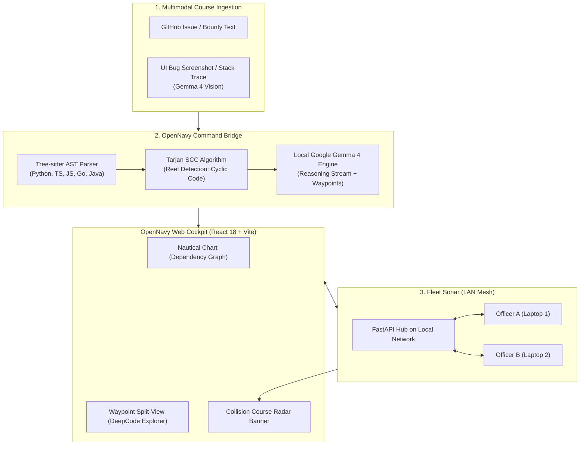

# OpenNavy: The Sovereign Fleet Navigator for Open Source Codebases
### Official Product, Architecture, and Business Specification
**Competition:** Major League Hacking (MLH) - Hacktoberfest 2026  
**Target Tracks:**  
1. **Best Open-Source AI Project** (DigitalOcean / Hacktoberfest 2026)  
2. **Best Use of Gemma 4** (Google DeepMind)  
**License:** MIT License (100% Permissive Open Source)

---

## 1. Executive Summary and Brand Identity

OpenNavy is a sovereign developer cockpit and local-first multiplayer architectural radar designed to solve two critical crises in modern software engineering:

1. **Open-Source Contributor Dropout:** 80% of software engineers abandon their initial contributions to unfamiliar open-source codebases because deciphering a 50,000-line architecture takes days of cognitive strain.
2. **The Cloud AI Compliance Barrier:** Engineering organizations in regulated sectors (finance, healthcare, defense, government) are strictly barred from adopting cloud AI assistants (Claude Code, Cursor, GitHub Copilot) because transmitting proprietary code across third-party servers breaches regulatory frameworks (SOC2, GDPR, ISO 27001).

OpenNavy dissolves this barrier by turning codebase navigation and issue resolution into an interactive, multiplayer nautical chart powered by Google DeepMind Gemma 4 running 100% locally on standard consumer hardware, connected across peer workstations over a local area network (LAN) mesh via WebSockets without reaching the public internet.

```
       __...--~~~~~-._   _.-~~~~~--...__
     //               `V'               \\ 
    //                 |                 \\
   //__...--~~~~~~-._  |  _.-~~~~~~--...__\\
  //__.....----~~~~._\ | /_.~~~~----.....__\\
 ===================\\\|///===================
                     `---'
       O P E N N A V Y  ·  F L E E T  O S
```

### The Nautical Metaphor System
* **The Codebase:** *The Uncharted Archipelago* (The ocean of directories, legacy modules, and unfamiliar code).
* **Code Navigator:** *The Nautical Chart* (Interactive topological dependency graph generated via Tree-sitter and Tarjan's SCC algorithm).
* **Issue Resolver:** *The Course Plotter* (Multimodal issue ingestion synthesizing exact implementation waypoints and checklists).
* **LAN Multiplayer:** *The Fleet Sonar* (Live peer presence radar and real-time architectural collision alerts).
* **AI Engine:** *The Admiralty AI* (Google Gemma 4 reasoning locally with zero telemetry).

---

## 2. Strategic Track Alignment

### A. Track 1: Best Open-Source AI Project (DigitalOcean / Hacktoberfest 2026)
* **Tailored for Hacktoberfest:** OpenNavy empowers any developer to complete open-source Pull Requests without onboarding friction or codebase disorientation.
* **100% Permissive Open Source (MIT):** Full transparency, self-hostable, zero vendor lock-in.
* **Open-Weights Harness:** Integrates lightweight open models (`gemma4:e4b` / `gemma4:e2b`) with deterministic syntax engines (Tree-sitter) and topological graph solvers (Tarjan).

### B. Track 2: Best Use of Gemma 4 (Google DeepMind)
* **Multimodal Issue Ingestion:** Contributors can submit raw issue text or drop bug screenshots, visual UI anomalies, and terminal stack traces. **Gemma 4 Vision** evaluates the visual artifact, correlates it with the Tree-sitter AST, and points to exact source coordinates.
* **Native Reasoning (`<|think|>`):** Streams internal reasoning traces directly into the cockpit UI as the *"Admiralty Reasoning Stream"*, demonstrating how the model deduced dependencies before issuing action steps.
* **High Efficiency on Commodity Hardware:** Quantized execution (Q4_K_M) running at 10-45 tokens/second on consumer laptops without cloud subscription costs or rate limits.

---

## 3. Core Functional Trilogy



---

### Module 1: The Nautical Chart (Code Navigator)
* **Goal:** Replace outdated README files and static documentation with an interactive, live topological map.
* **Technical Mechanism:**
  1. Tree-sitter parses the repository Abstract Syntax Tree across multiple languages (Python, TypeScript, JavaScript, Go, Java).
  2. **Tarjan's Algorithm** evaluates the directed import and invocation matrix, pinpointing Strongly Connected Components (SCC).
  3. Cyclical and tightly coupled modules are highlighted as **"Dangerous Reefs"**, alerting contributors before refactoring or editing.

---

### Module 2: The Course Plotter (IssueCraft + Gemma 4 Multimodal)
* **Goal:** Minimize the cognitive distance between reading an issue and writing the first verified line of code.
* **Technical Mechanism:**
  1. The developer pastes an issue link or drops an image containing an interface glitch or terminal exception.
  2. **Google Gemma 4** evaluates textual and visual context, references the repository symbol index, and generates the **Nautical Flight Plan**:
     - **Waypoints (Exact Coordinates):** Clickable links with line ranges (e.g., `[src/auth/jwt.py:42-65]`). Clicking any waypoint smoothly scrolls the split-view AST viewer to the exact line range.
     - **Blast Radius Warning:** Flags collateral modules that might break due to coupling.
     - **Action Steps:** 3 to 4 sequential implementation instructions.
     - **PR Template & Conventional Commit:** Pre-drafts standardized commit messages (`feat(...)`, `fix(...)`) and PR documentation.

---

### Module 3: The Fleet Sonar (LAN Multiplayer Radar)
* **Goal:** Eliminate code collisions and merge conflicts during sprints, hackathons, and corporate air-gapped development.
* **Technical Mechanism:**
  1. The central host machine serves a lightweight WebSocket event hub over FastAPI (`/ws/sonar`).
  2. Team members on the same Wi-Fi router or hotspot join automatically with zero account creation friction.
  3. **Live Crew Presence:** The file tree displays active badges indicating files currently opened by teammates.
  4. **Architectural Collision Alert:**
     If Developer A inspects `auth_service.py` while Developer B inspects `session_store.py` (which depend mutually on each other in Tarjan's SCC matrix), both screens trigger an instant warning:
     > **COLLISION COURSE DETECTED**  
     > *Officer Daniel and Officer Carlos are modifying coupled modules (`auth_service` <-> `session_store`). Synchronize changes before committing.*

---

## 4. Business Model and Commercial Strategy

OpenNavy adopts a sustainable **Open-Core** model:

| Tier | Target Audience | Deployment | Pricing | Key Capabilities |
| :--- | :--- | :--- | :--- | :--- |
| **Community Edition (Open Source)** | Open-source maintainers, Hacktoberfest contributors, independent devs | Localhost / Self-hosted Docker | **$0 (MIT License)** | Full local inference with Gemma 4, Nautical Chart, Course Plotter, and Fleet Sonar over LAN. |
| **Enterprise Fleet (Sovereign B2B)** | Banks, defense, healthcare, regulated enterprises | On-Premise Kubernetes / Private VPC | **$35 / dev / month** | Private GitLab/Gitea webhooks, SSO/LDAP integration, ISO/IEC 5055 audit reports, and governance rule engines. |

### Value Proposition:
* **Open Source Foundations:** Sponsor and adopt OpenNavy to prevent maintainer burnout and accelerate newcomer onboarding.
* **Security Officers (CISOs):** Acquire a compliant, air-gapped engineering intelligence alternative to cloud assistants with zero code leakage risk.

---

## 5. Live Demo Script (3-Minute MLH Rehearsal)

### Setup:
Two laptops connected to the same local Wi-Fi router, running entirely offline without external internet requirements.

* **0:00 - 0:40 | The Hook (The Sovereignty Challenge):**
  > "Judges, look around this venue. If the convention Wi-Fi fails right now, every cloud-dependent developer assistant stops working immediately. Furthermore, regulated enterprises in defense and healthcare strictly prohibit sending source code outside their network. Today, we present **OpenNavy**: the sovereign, multiplayer developer cockpit for open-source software, powered 100% locally by Google Gemma 4 under the MIT License."

* **0:40 - 1:40 | Action 1: Multimodal Course Plotter (Laptop 1):**
  - Developer 1 opens a complex codebase inside OpenNavy.
  - Drops a bug screenshot directly onto the Course Plotter panel.
  - **Gemma 4 Vision** processes the visual defect, cross-references Tree-sitter's AST index, and streams the plan:
    - Pins the exact coordinates `[services/auth.py:54-72]`.
    - Clicking the waypoint scrolls the split-pane AST viewer straight to the code.
    - Highlights the Tarjan dependency cycle warning.

* **1:40 - 2:30 | Action 2: Fleet Sonar in Action (Laptop 2):**
  - Developer 2 connects over the local network.
  - Both screens receive the broadcasted blueprint.
  - Developer 2 opens a coupled dependency file, immediately triggering the visual **Collision Course Alert**:
    > "Collision Warning: Teammates are inspecting strongly connected components. Coordinate before committing."

* **2:30 - 3:00 | Conclusion & Call to Action:**
  > "OpenNavy is not a passive auditor or a blind code generator. It is the compass and fleet radar guiding contributors across unfamiliar software oceans while guaranteeing absolute privacy. 100% open-source, MIT-licensed, and built for the future of sovereign engineering."

---

## 6. Quick Start Guide

### 1. Launch Central Server (Host Machine):
```powershell
.\scripts\start-server.ps1 -Model "gemma4:e4b"
```

### 2. Connect Crew Members (Same LAN):
In the `.env` file of client laptops:
```env
AI_SERVER_URL=http://<HOST_LAN_IP>:11434/v1
SONAR_WS_URL=ws://<HOST_LAN_IP>:8000/ws/sonar
AI_MODEL_NAME=gemma4:e4b
```

### 3. Verify Live Streaming Inference:
```bash
python scripts/test-inference.py http://<HOST_LAN_IP>:11434
```
